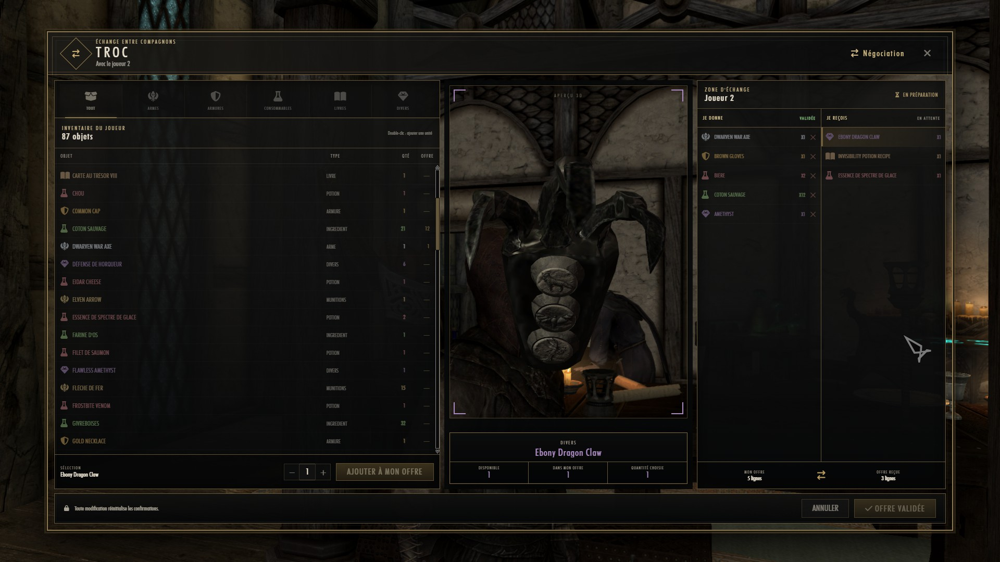
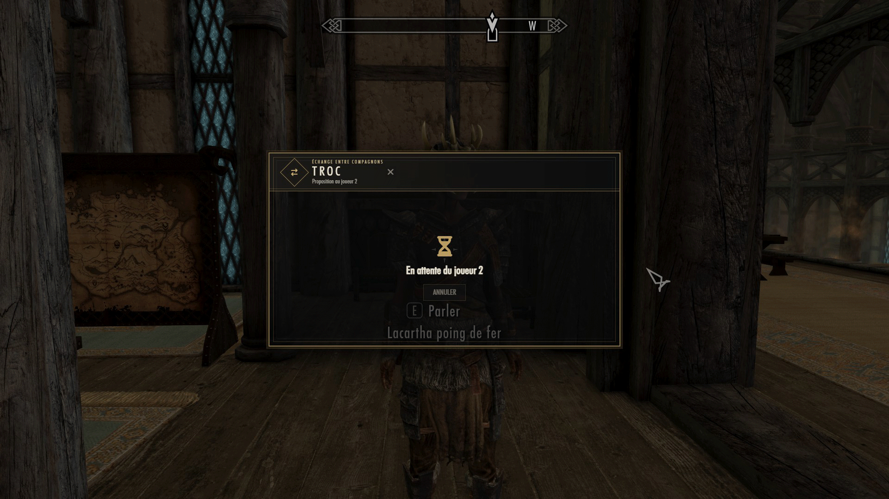

  

# Skyrim Together Reborn Enhanced

  <a href="docs/project/STATUS.md"><strong>Current development</strong></a>

  
  
  
   
  
  
  
   
  
  
  
  
   
  

**Skyrim’s adventure, with a party by your side.**

Skyrim Together Reborn Enhanced (**STRE**) is an independent community fork of Skyrim Together Reborn. The goal is simple: experience Skyrim’s adventure together, with a shared beginning, meaningful character choices and cooperative systems that help your group stay together. This is still Skyrim—not an MMO or a replacement campaign.

> **Everything STRE is Alpha.** All features and STRE integrations below are works in progress. Expect unfinished content, bugs and changes. A working feature is not a finished feature.

The focus is small-party co-op: **2–4 players** are the primary multiplayer target. A standalone Solo start is also available; the broader **1–10-player goal** is not a claim that ten-player campaigns are fully validated.

## Features — Alpha

### Alternate Start — Alpha

Begin at the STRE inn instead of the Helgen cart. Meet the group and create your character before setting out. The starting flow also has a local Solo path that does not require a server.

[Explore Alternate Start](docs/features/alternate-start/README.md)

### Classes & starting equipment — Alpha

Choose from the available classes and starting loadouts to give your character a role from the beginning. Equipment and spells follow those choices. The class roster, kits and cooperative abilities are still being expanded; the complete planned catalog is not yet available.

[Explore character creation](docs/features/alternate-start/README.md)

### Shared campaign & checkpoints — Alpha

STRE gives your group a shared campaign identity and coordinates checkpoints with each member’s own Skyrim save. The campaign keeps a fixed party: everyone needs to be present to progress, and joining after the campaign starts is not supported.

Collective recovery is part of this system, with further Skyrim 1.7 validation still needed.

[Explore campaign continuity](docs/architecture/CAMPAIGN_STATE.md)

### A shared inn & Messire Valen — Alpha

The inn gives the party a common starting point, with Messire Valen at the heart of its introduction. His dialogue and voice work, the inn’s layout and its housing features are still taking shape. Ten usable player rooms and persistent room assignments remain goals, not finished features.

[Explore the headquarters](docs/features/alternate-start/HEADQUARTERS_INN.md)

### Player trading & 3D previews — Alpha

Exchange items through a dedicated player-to-player trading interface, with native 3D previews to see what is on offer. STRE coordinates the exchange on the server; item-handling and recovery edge cases are still being refined.

[Explore trading](docs/features/trading/README.md)

See the Alpha trading preview

  

  

### Shared physical objects — Alpha

**World Sync** brings dropped items and supported movable objects into the shared experience. It coordinates their state and final placement while Skyrim handles physics locally. Coverage is still limited: not every object type is supported, and persistent world-object changes across restarts are not yet implemented.

[Explore World Sync](docs/features/world-sync/README.md)

### An atmospheric main menu — Alpha

An animated background and custom branding give STRE its own welcome while keeping Skyrim’s familiar menu actions. The system also supports an optional, skippable intro. That intro is not distributed while its music permissions remain unresolved.

[Explore the main menu](docs/features/main-menu/README.md)

## Integrations — Alpha

### Better Grabbing 2.0 — Alpha integration

Pick up, rotate and place supported objects with **Better Grabbing 2.0**. STRE connects these interactions to World Sync. More testing is still needed for multiplayer object manipulation on Skyrim 1.7.

Better Grabbing is an external dependency, installed separately—not bundled with STRE.

[Integration details](docs/features/world-sync/BETTER_GRABBING_INTEGRATION.md)

### EEKs Fireplace Resource — Alpha content integration

STRE’s current content uses **EEKs Fireplace Resource**, also installed separately. STRE does not redistribute its assets; Embers HD is not required for this fireplace integration.

Runtime prerequisites are **SKSE64 2.3.1** and the **Address Library matching Skyrim 1.7.104.0**.

[Dependencies and setup](docs/user/INSTALLATION.md)

## Trying the alpha

**The Skyrim 1.7 port is integrated into `main`.** Current development targets **Skyrim Special Edition 1.7.104.0 — Steam, Windows x64** exclusively. Skyrim 1.6 is no longer maintained by the current development branch.

Start with the [installation guide](docs/user/INSTALLATION.md), [build guide](docs/development/BUILDING.md) and [compatibility matrix](docs/testing/COMPATIBILITY_MATRIX.md). Development builds are for testing, not a promise of a finished campaign or compatibility with every mod.

### Historical download — Alpha

  

The historical **STRE 0.4.0-alpha.1** release targets **Skyrim 1.6.1170**. **Do not use that archive with Skyrim 1.7.104.0.** The port in `main` is not a new public release announcement.

For a historical release, use its `STRE-v<version>-windows-x64.zip` asset, not GitHub’s automatically generated source archive.

## Follow the project or lend a hand

Curious about what works today or what comes next? The [current status](docs/project/STATUS.md) records implementation and testing; the [roadmap](ROADMAP.md) describes the goals still ahead. Full campaign continuity, broader multiplayer coverage, classes, Valen and the inn all remain active work.

Code, playtesting, documentation, art and voice contributions are welcome. Start with [Contributing](CONTRIBUTING.md) and the [contributor paths](docs/production/ONBOARDING_PATHS.md). For help, see [Support](SUPPORT.md); report vulnerabilities through the [security policy](SECURITY.md).

For the technical side, see the [documentation portal](docs/README.md), [system overview](docs/architecture/SYSTEM_OVERVIEW.md), [network rules](docs/architecture/NETWORK_PROTOCOL.md) and [architecture decisions](docs/architecture/ADRs/). Release history lives in the [changelog](CHANGELOG.md).

## Credits & license

Built on the work of the **Tilted Phoques team** and all Skyrim Together Reborn contributors. STRE is an independent community fork, not an official release from the original team, Bethesda Game Studios or ZeniMax Media.

Distributed under **GNU GPLv3**. See the repository [license](LICENSE) and [NOTICE](NOTICE.md) for attribution and notices, and [Upstream](UPSTREAM.md) for the project’s relationship with Skyrim Together Reborn.
